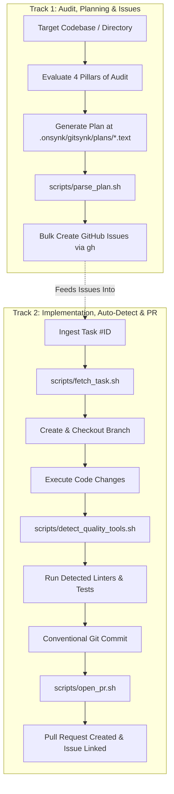
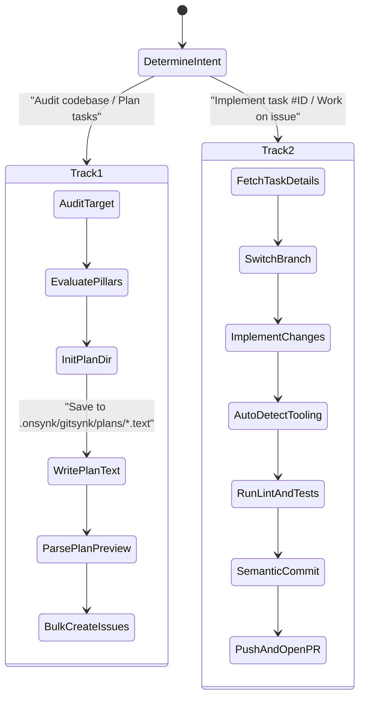

# GitSynk: Universal Autonomous Engineering Workflow

**GitSynk** is a universal, language-agnostic autonomous engineering skill for AI agents. It bridges high-level architectural auditing and planning with day-to-day Git and GitHub CLI (`gh`) execution, providing a closed-loop engineering workflow.



---

## Quick Navigation

- [Track 1: Universal Technical Audit & GitHub Issues](#track-1-universal-technical-audit-plan-generation--github-issues)
  - [The 4 Core Pillars](#1-the-4-core-pillars-of-technical-audit)
  - [Generating Plans in `.onsynk/gitsynk/plans/*.text`](#2-generating-plans-as-text-at-onsynkgitsynkplanstext)
  - [Bulk Issue Creation](#3-automated-github-issue-creation)
- [Track 2: Task Implementation & PR Automation](#track-2-task-implementation-auto-detection--gitpr-automation)
  - [Context Ingestion & Branching](#1-context-ingestion--branch-management)
  - [Auto-Detected Verification Matrix](#2-auto-detected-quality--verification-engine)
  - [Commit & Pull Request Workflow](#3-automated-commit-pr--issue-lifecycle)
- [Helper Scripts Reference](#helper-scripts-reference)
- [Agent Operational Runbook](#agent-operational-runbook)

---

## Track 1: Universal Technical Audit, Plan Generation & GitHub Issues

Use Track 1 when instructed to review, audit, analyze, or plan work for any codebase, directory, or individual file across any language or framework.

### 1. The 4 Core Pillars of Technical Audit

Every audit must systematically evaluate the target against these 4 pillars:

| Pillar | Focus Areas & Invariants | Typical Findings |
| :--- | :--- | :--- |
| **1. Critical Bugs & Runtime Safety** | Null safety, type mismatches, unhandled exceptions, unhandled nil/None, resource leaks, missing error returns, boundary conditions. | Nil pointer panic in Go, unhandled `undefined` in TS, missing catch blocks, file descriptor / connection leaks. |
| **2. Performance Bottlenecks** | Algorithmic complexity ($O(N^2) \to O(N)$), $N+1$ query loops, blocking I/O on event loops, unindexed DB queries, heavy re-renders, uncontrolled memory growth. | Database query executed inside `foreach`, synchronous `fs.readFileSync` inside Express router, missing pagination. |
| **3. Security & Concurrency** | Injection flaws (SQL, Command, XSS), broken authorization/authentication, secret leakage, race conditions, unsynchronized shared mutable state, deadlocks. | Raw SQL string interpolation, missing CSRF token, unsynchronized map access across goroutines, unmasked API key in code. |
| **4. Architecture & Code Quality** | SOLID principles, single responsibility, leaking domain boundaries, tight coupling, code duplication (DRY), high cyclomatic complexity, lack of test coverage. | 1,000-line controller, domain model directly issuing HTTP calls, repetitive boilerplate, untested business calculation. |

### 2. Generating Plans as Text at `.onsynk/gitsynk/plans/*.text`

All audit findings and development roadmaps must be saved as text files located within the project's `.onsynk/gitsynk/plans/` directory with the `.text` extension (e.g. `.onsynk/gitsynk/plans/plan.text` or `.onsynk/gitsynk/plans/<module-or-date>.text`).

#### Initializing a New Plan File:
Use the helper script to scaffold a new plan:
```bash
bash scripts/create_plan.sh [optional_name]
# Example: bash scripts/create_plan.sh audit
# Output: .onsynk/gitsynk/plans/audit.text
```

See [references/plan_format.md](./references/plan_format.md) for full schema.

#### Standard Block Template:
```markdown
### [TASK-01] Concise Imperative Title
- **Type**: bug | enhancement
- **Priority**: 🚨 High-Top | ⚡ Medium | 🌱 Regular
- **Scope**: component/domain-name
- **Pillar**: Critical Bugs & Runtime Safety | Performance Bottlenecks | Security & Concurrency | Architecture & Code Quality
- **Target**: src/path/to/file.ext
- **Description**: Concise description of the defect, vulnerability, or debt.
- **Proposed Solution**: Architectural and implementation plan to fix the item.
- **Acceptance Criteria**:
  - [ ] Definition of done item 1
  - [ ] Definition of done item 2
```

### 3. Automated GitHub Issue Creation

Once the `.text` plan file is saved, parse and convert items into live GitHub issues. The parser automatically detects files in `.onsynk/gitsynk/plans/*.text` if no path is explicitly provided.

#### Previewing Parsed Tasks (Dry-Run):
```bash
# Auto-detects latest .onsynk/gitsynk/plans/*.text
bash scripts/parse_plan.sh --preview

# Or specify a target plan file
bash scripts/parse_plan.sh .onsynk/gitsynk/plans/audit.text --preview
```

#### Bulk Creating Issues:
```bash
# Auto-detects latest .onsynk/gitsynk/plans/*.text
bash scripts/parse_plan.sh --execute

# Or specify a target plan file
bash scripts/parse_plan.sh .onsynk/gitsynk/plans/audit.text --execute
```

#### Creating a Single Ad-Hoc Issue:
```bash
bash scripts/create_task.sh \
  --title "Fix SQL injection in UserRepository" \
  --type "bug" \
  --priority "🚨 High-Top" \
  --body "Full details of the vulnerability..."
```

#### GitHub Labels Applied:
- **Type Labels**: `bug`, `enhancement`, `refactor`, `security`, `performance`
- **Priority Badges**:
  - `🚨 High-Top` (Color `#B60205`): Critical crashes, security holes, P0 blockers.
  - `⚡ Medium` (Color `#FBCA04`): Performance bottlenecks, major features, P1 items.
  - `🌱 Regular` (Color `#0E8A16`): Code quality, documentation, maintenance, P2 items.

---

## Track 2: Task Implementation, Auto-Detection & Git/PR Automation

Use Track 2 when assigned a specific task ID (e.g., `#42` or `42`) or instructed to implement a plan item.

### 1. Context Ingestion & Branch Management

#### Fetch Context & Switch Branch in One Step:
```bash
bash scripts/fetch_task.sh #42 --checkout
```

- Ingests issue details via `gh issue view 42`.
- Reads title, body, state, and labels.
- Computes semantic branch name:
  - If labeled `bug` or `security`: `fix/issue-42-<slug>`
  - If labeled `enhancement` or `feature`: `feat/issue-42-<slug>`
  - If labeled `refactor`: `refactor/issue-42-<slug>`
- Switches to the branch locally, tracking remote if it already exists or creating it if new.

### 2. Auto-Detected Quality & Verification Engine

Before committing any code, GitSynk dynamically determines the project's native tooling by inspecting root configuration files. See [references/stack_matrix.md](./references/stack_matrix.md).

#### Interrogate Project Tooling:
```bash
bash scripts/detect_quality_tools.sh . --detect
```
Returns a JSON summary of detected stack and commands:
```json
{
  "stack": "PHP",
  "test_command": "vendor/bin/pest",
  "lint_command": "vendor/bin/pint --test",
  "format_command": "vendor/bin/pint",
  "typecheck_command": ""
}
```

#### Run Verification Suites:
```bash
# Run linting and static analysis
bash scripts/detect_quality_tools.sh . --lint

# Run test runner
bash scripts/detect_quality_tools.sh . --test

# Run full verification suite (lint + typecheck + test)
bash scripts/detect_quality_tools.sh . --all
```

#### Supported Tooling Matrix (Summary):
- **PHP**: `composer.json` $\to$ Pint (`vendor/bin/pint`), PHPStan (`vendor/bin/phpstan`), Pest (`vendor/bin/pest`), PHPUnit (`vendor/bin/phpunit`).
- **Node/TS**: `package.json` $\to$ ESLint (`npx eslint .`), Prettier, TSC (`npx tsc --noEmit`), Jest/Vitest/Pnpm/Yarn/Bun test.
- **Python**: `pyproject.toml`, `requirements.txt` $\to$ Ruff, Flake8, Mypy, Pytest.
- **Rust**: `Cargo.toml` $\to$ `cargo clippy --all-targets -- -D warnings`, `cargo test`, `cargo fmt -- --check`.
- **Go**: `go.mod` $\to$ `golangci-lint run`, `go vet ./...`, `go test -v -race ./...`.
- **Flutter / Dart**: `pubspec.yaml` $\to$ `flutter analyze`, `flutter test`, `dart test`.
- **Java / Kotlin**: `pom.xml` / `build.gradle` $\to$ `mvn test`, `./gradlew check`, `./gradlew test`.
- **C# / .NET**: `*.sln`, `*.csproj` $\to$ `dotnet format --verify-no-changes`, `dotnet test`.
- **Ruby**: `Gemfile` $\to$ `bundle exec rubocop`, `bundle exec rspec`.

### 3. Automated Commit, PR & Issue Lifecycle

After verifying the implementation against the auto-detected test suite:

#### Step 1: Stage Modified Files
Stage strictly the files modified for the issue:
```bash
git add src/Repositories/UserRepository.php tests/Unit/UserRepositoryTest.php
```

#### Step 2: Conventional Semantic Commit
Write a conventional commit that references the task ID:
```bash
git commit -m "fix(auth): sanitize user lookup queries with prepared statements (fixes #42)"
```

#### Step 3: Automated Push & Pull Request Creation
```bash
bash scripts/open_pr.sh --issue 42
```
- Pushes the feature branch to origin: `git push -u origin <branch>`
- Assembles a structured Pull Request body with:
  - Summary of commits
  - Auto-closing directive (`Closes #42`)
  - Verification checklist
- Invokes `gh pr create`
- Leaves a notification comment on issue `#42` with the PR link

#### Step 4: Issue Resolution (If Direct Merge or Closure Required)
```bash
gh issue comment 42 --body "Implemented and verified via PR $(git rev-parse --abbrev-ref HEAD)."
gh issue close 42 --reason "completed"
```

---

## Helper Scripts Reference

All scripts reside in the `scripts/` directory:

| Script | Purpose | Key Flags & Usage |
| :--- | :--- | :--- |
| `scripts/create_plan.sh` | Scaffold a new plan file at `.onsynk/gitsynk/plans/*.text` | `[plan_name]` |
| `scripts/parse_plan.sh` | Parse `.onsynk/gitsynk/plans/*.text` and bulk-generate issues | `[path.text] [--preview \| --execute]` |
| `scripts/fetch_task.sh` | Fetch issue context from GitHub and configure git branch | `<#ID> [--checkout] [--prefix <name>]` |
| `scripts/create_task.sh` | Create a categorized GitHub issue with badges | `--title <t> --type <type> --priority <p> --body <b>` |
| `scripts/detect_quality_tools.sh` | Interrogate project stack and run lint/tests | `[target_dir] [--detect \| --lint \| --test \| --all]` |
| `scripts/open_pr.sh` | Push branch, open PR, and link to issue | `[--issue <ID>] [--title <t>] [--draft] [--no-comment]` |

---

## Agent Operational Runbook

When the user gives a command, map it to the corresponding flow:



### Scenario A: "Audit this module / directory and create issues"
1. Perform deep static analysis against the **4 Core Pillars**.
2. Initialize or write to `.onsynk/gitsynk/plans/<name>.text` using `bash scripts/create_plan.sh [name]`.
3. Fill in structured task blocks (`### [TASK-01]`, etc.).
4. Run `bash scripts/parse_plan.sh --preview` to confirm valid parsing.
5. Run `bash scripts/parse_plan.sh --execute` to generate GitHub issues.
6. Provide a summary table of created issues to the user.

### Scenario B: "Implement task #54"
1. Ingest task: `bash scripts/fetch_task.sh #54 --checkout`.
2. Inspect the codebase and execute the required changes.
3. Auto-detect quality tools: `bash scripts/detect_quality_tools.sh . --all`.
4. Stage changes: `git add <modified_files>`.
5. Commit: `git commit -m "<type>(<scope>): <summary> (fixes #54)"`.
6. Open PR: `bash scripts/open_pr.sh --issue 54`.
7. Report the created PR link and verification status.
